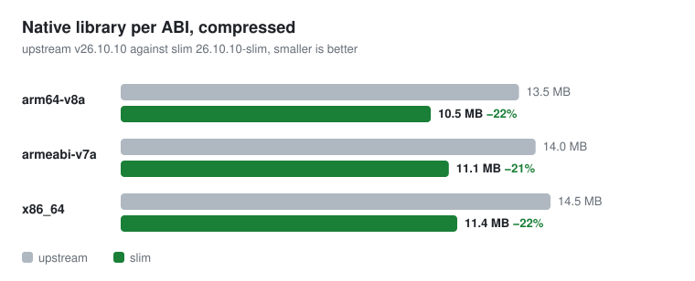
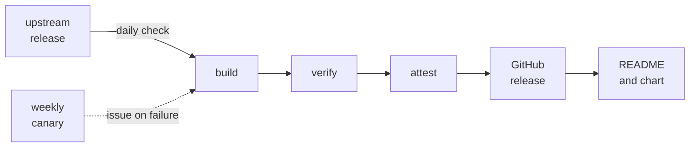

<!-- The parts between the release markers are rewritten by tools/readme at the end of every release build. Edit everything else freely. -->

<div align="center">

# AndroidLibXrayLite · slim

**Xray-core for Android, <!-- release:percent -->20–22%<!-- /release:percent --> smaller once compressed.**<br>
An unofficial build of `libv2ray` without TUN, WireGuard and MASQUE. Same Java API, built and attested by CI, updated automatically.

[](https://github.com/dec0iiyy/AndroidLibXrayLite-slim/releases/latest)
[](https://github.com/dec0iiyy/AndroidLibXrayLite-slim/actions/workflows/build.yml)
[](LICENSE)


[Quick start](#quick-start) · [Sizes](#sizes) · [What is inside](#what-is-inside) · [Verify](#verify-what-you-download) · [Updates](#how-updates-work)

</div>

> [!NOTE]
> This is an **unofficial** build of [AndroidLibXrayLite](https://github.com/2dust/AndroidLibXrayLite). It is not affiliated with 2dust or the XTLS project. If you need WireGuard or the built-in TUN, use upstream.

## Quick start

**1. Add the repository** in `settings.gradle.kts`. The AAR is resolved straight from the GitHub release, no extra hosting:

```kotlin
dependencyResolutionManagement {
    repositories {
        exclusiveContent {
            forRepository {
                ivy {
                    url = uri("https://github.com/dec0iiyy/AndroidLibXrayLite-slim/releases/download")
                    patternLayout { artifact("v[revision]/[module]-[revision].[ext]") }
                    metadataSources { artifact() }
                }
            }
            filter { includeModule("io.github.dec0iiyy", "libv2ray") }
        }
    }
}
```

**2. Add the dependency** in `app/build.gradle.kts`:

<!-- release:gradle -->
```kotlin
// app/build.gradle.kts
dependencies {
    implementation("io.github.dec0iiyy:libv2ray:26.10.10-r1-slim@aar")
}
```
<!-- /release:gradle -->

Prefer a file? Download <!-- release:file -->`libv2ray-26.10.10-r1-slim.aar`<!-- /release:file --> from the [releases](https://github.com/dec0iiyy/AndroidLibXrayLite-slim/releases) page. `SHA256SUMS` is attached to every release, and the keep rules ship inside the AAR (`-keep class go.** { *; }`, `-keep class libv2ray.** { *; }`).

## Sizes

<p align="center">
  <picture>
    <source media="(prefers-color-scheme: dark)" srcset="docs/sizes-dark.svg">
    
  </picture>
</p>

<!-- release:sizes -->
`libgojni.so` per ABI, upstream `v26.10.10` against `26.10.10-r1-slim`. "Compressed" is the deflated size of the file inside the AAR, which is roughly what an APK download carries.

| ABI | upstream | slim | upstream, compressed | slim, compressed |
|---|---|---|---|---|
| arm64-v8a | 37.3 MB | 26.9 MB | 13.5 MB | 10.6 MB |
| armeabi-v7a | 36.2 MB | 28.1 MB | 14.0 MB | 11.2 MB |
| x86_64 | 39.8 MB | 29.1 MB | 14.5 MB | 11.4 MB |

The AAR files are 64.9 MB (upstream) and 33.2 MB (slim), but that is not a like-for-like comparison. The upstream AAR also contains an x86 library (15.0 MB compressed) and `geoip.dat` / `geosite.dat` (27.9 MB, 7.9 MB compressed). **The slim AAR contains neither**: ship your own geo files if your config uses them.
<!-- /release:sizes -->

These numbers belong to one release. The notes of every release give the exact size of the arm64-v8a library and the change since the previous release.

## What is inside

| Property | Value |
|---|---|
| **Xray‑core** | <!-- release:xray -->26.10.10<!-- /release:xray --> |
| **Toolchain** | Go <!-- release:go -->1.27.1<!-- /release:go -->, `gomobile bind -androidapi 24` |
| **ABIs** | `arm64-v8a`, `armeabi-v7a`, `x86_64` (no 32-bit `x86`). The arm64 and x86_64 libraries are 16 KB page aligned |
| **minSdk** | 24 |
| **Java API** | Identical to upstream (`libv2ray.Libv2ray`, `CoreController`, `CoreCallbackHandler`, `ProcessFinder`), so it is a drop-in replacement |

| ✅ Kept | ❌ Removed |
|---|---|
| VLESS, VMess, Trojan, Shadowsocks (including 2022), Hysteria2, SOCKS, HTTP, freedom, blackhole, dns, dokodemo, loopback<br>Transports: tcp, WebSocket, gRPC, HTTPUpgrade, XHTTP, Hysteria<br>TLS (uTLS, ECH) and REALITY<br>Routing, DNS (including DoH), stats, policy, observatory, reverse | The TUN inbound, WireGuard, MASQUE, mKCP and xdrive implementations<br>metrics/pprof<br>The gRPC API (commander)<br>Loading a config over HTTP and the command line |

> [!IMPORTANT]
> The config types of the removed features stay, so a config that asks for them fails with `... is not registered` at start instead of failing to parse. Together they pulled in gVisor, wireguard-go and netlink, which is where most of the size went. Use an external tun2socks (hev-socks5-tunnel, tun2socks) if you need a VPN service.

<details>
<summary>Build flags</summary>

`-trimpath -tags grpcnotrace,http2legacy -ldflags='-s -w -buildid= -checklinkname=0 -extldflags=-Wl,--pack-dyn-relocs=android'`. Packed relocations need Android 6.0 (API 23) or newer.

`http2legacy` keeps the HTTP/2 client of `golang.org/x/net`. Built with Go 1.27, the default client hands requests to `net/http`, which dials a new connection for every request that waits for a TLS handshake. When a censor stalls the handshake, XHTTP's `xmux.maxConnections` stops limiting anything and a client opens a connection per session ([XTLS/Xray-core#6797](https://github.com/XTLS/Xray-core/issues/6797)). The tags live in `versions.env`.

A rebuild of a version that is already released gets a revision, for example `26.10.10-r1-slim`.

</details>

## Verify what you download

Every release has a `SHA256SUMS` file, and its release notes contain the SHA-256 of the AAR. Every release is built by the [`build` workflow](.github/workflows/build.yml) and carries a signed build provenance attestation (Sigstore), which ties the file to the workflow run and the commit that produced it:

```sh
gh attestation verify libv2ray-<version>-slim.aar --repo dec0iiyy/AndroidLibXrayLite-slim
shasum -a 256 -c SHA256SUMS
```

<details>
<summary>Pin the AAR in Gradle dependency verification</summary>

Add it to `gradle/verification-metadata.xml` (`./gradlew --write-verification-metadata sha256` writes the entry for you; every release note also has a ready snippet):

<!-- release:verification -->
```xml
<component group="io.github.dec0iiyy" name="libv2ray" version="26.10.10-r1-slim">
   <artifact name="libv2ray-26.10.10-r1-slim.aar">
      <sha256 value="0245f38ae9e7c7a8a7eb1496b5f8a09cfbcade8b97eb988f5059f35171647fb9" origin="GitHub release"/>
   </artifact>
</component>
```
<!-- /release:verification -->

</details>

## How updates work

Nothing has to be rebuilt by hand.



- **Automatic.** The `update` workflow runs daily, looks at the latest AndroidLibXrayLite release and, if there is no matching `-slim` release here, starts the `build` workflow. It builds, runs the tests, attests and publishes the release with checksums, licenses and a size report, then updates the numbers and the chart in this README, and opens an issue if something fails. GitHub can start scheduled runs hours late.
- **Canary.** The `canary` workflow runs every Monday and builds the latest wrapper against Xray-core `main` without publishing. If it fails, an issue appears before the next Xray release does, saying that `slim/` needs a change.
- **On demand.** Actions → `build` → Run workflow. `tag` is an AndroidLibXrayLite tag. `xray` is optional: an Xray-core tag, branch or commit (for example `v26.10.1` or `main`) to build into that wrapper before the wrapper itself is updated. Untick `publish` for a dry run that only uploads the files as a workflow artifact.
- **Locally.** <!-- release:local -->`./build-aar.sh v26.10.10` or `./build-aar.sh v26.10.10 main`<!-- /release:local -->.

The toolchain is pinned in `versions.env` (Go and NDK), so a new release does not change because a runner image did. If an upstream release needs a newer Go, the build stops with a message that says so; raise `GO_VERSION` in a commit and run it again.

<details>
<summary>Why this keeps working when Xray moves things around</summary>

- The patch is data, not code: `slim/hollow.txt` lists the packages whose implementation is hidden, `slim/forbidden.txt` lists what must never be linked, `slim/distro_all.go.txt` replaces Xray's `main/distro/all`.
- `slim/main.go` applies it to a copy of the module and then compiles. Whenever the remaining code still needs a symbol from a hidden file, it restores that file by itself, so no keep-list is maintained by hand.
- The build stops with a clear message instead of publishing a bad AAR when: a forbidden package is linked again (the message names the importer to add to `hollow.txt`), `verify/` fails (it also checks that WireGuard really is gone), or the arm64 library grows over the size budget (`MAX_ARM64_BYTES`, 30 MB).
- Every release note lists the largest packages in the arm64 library and the change in size since the previous release (`tools/sizes`), so a new heavy dependency shows up in review instead of in your APK.
- The numbers in this README and the size chart are generated from the published AARs by `tools/readme`, so they cannot drift from the release.

</details>

## Tested

`verify/main.go` starts a client and a server instance in one process and sends HTTP requests through SOCKS5: VLESS over ws, gRPC, XHTTP and HTTPUpgrade with TLS (uTLS fingerprint, pinned certificate), VMess, Trojan, Shadowsocks AEAD and 2022, SOCKS, HTTP and Hysteria2 with salamander. REALITY is only checked by parsing a config (it needs a real destination server). This is not a replacement for testing on a device.

## Build it yourself

You need git, Go and an Android NDK in the versions pinned in `versions.env` (other versions work with a warning).

<!-- release:build -->
```sh
ANDROID_NDK_HOME=$ANDROID_HOME/ndk/30.0.16248370 ./build-aar.sh v26.10.10
```
<!-- /release:build -->

The script clones the upstream tag, installs the matching gomobile, builds the patched copy of Xray-core, runs `verify/`, builds the three ABIs and writes the AAR, a POM, `THIRD_PARTY_LICENSES.txt`, `RELEASE_NOTES.md` (with the size report) and `SHA256SUMS` to `dist/`. Go records the build directory in the binary, so for a release build point `LIBV2RAY_WORK` at a neutral directory.

## License

[LGPL-3.0](LICENSE), inherited from AndroidLibXrayLite. The AAR also contains Xray-core (MPL-2.0) and other Go modules; their licenses are in [THIRD_PARTY_LICENSES.txt](THIRD_PARTY_LICENSES.txt). The build scripts here are the way to rebuild the library from source.
